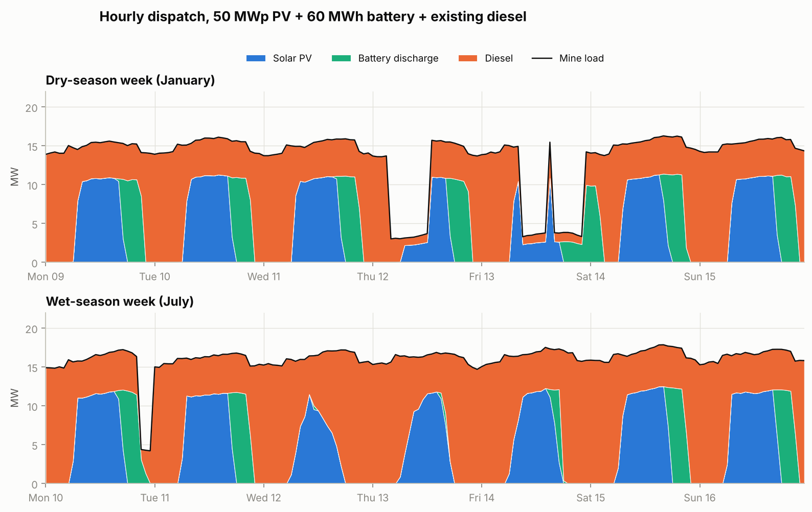
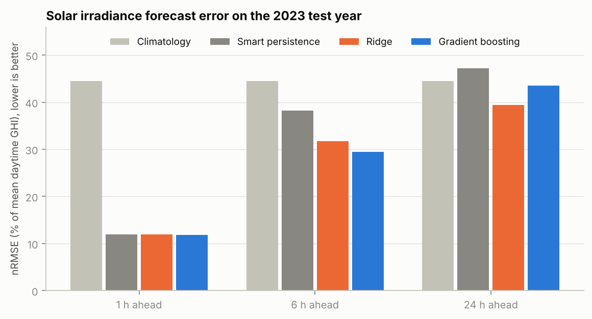
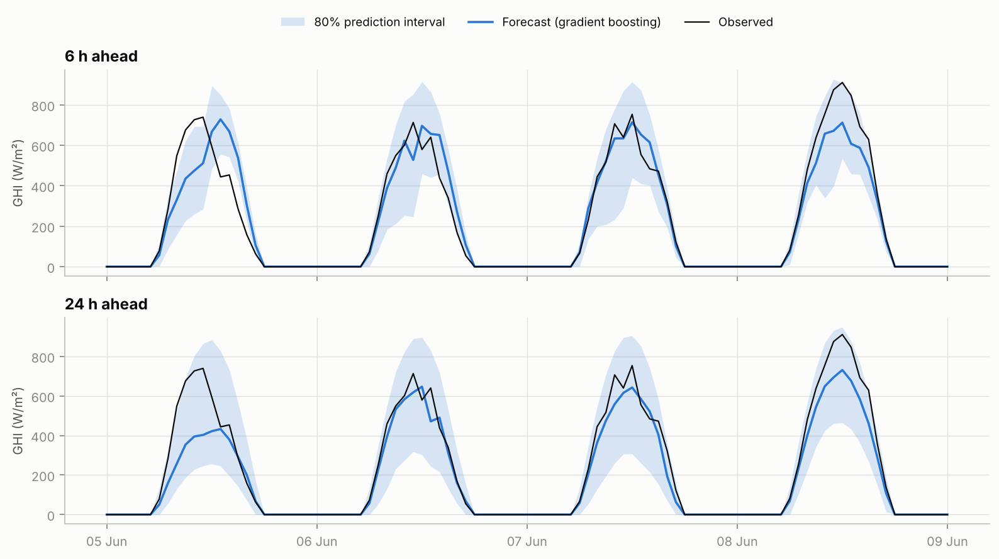
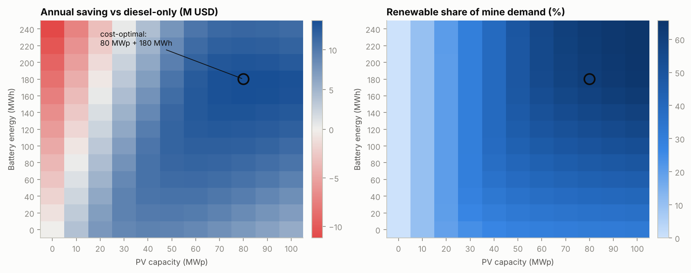
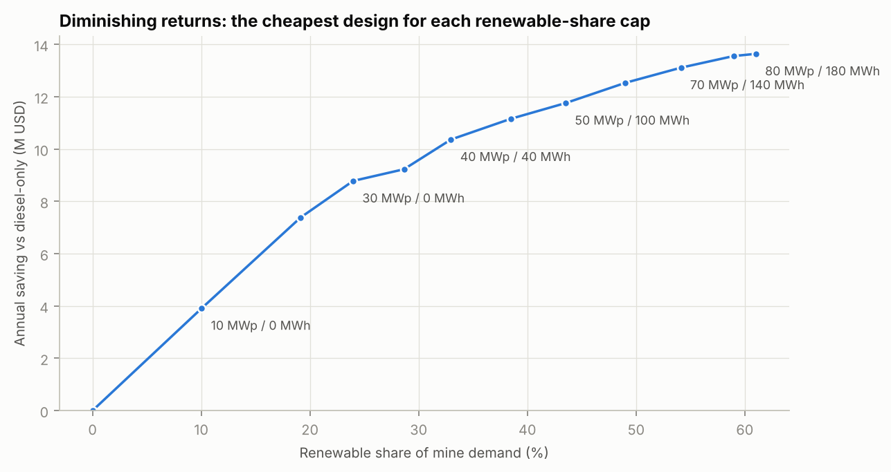
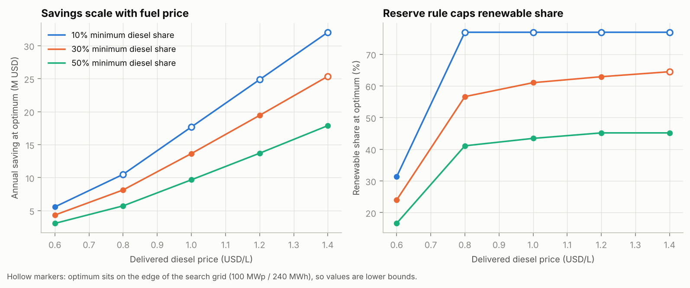
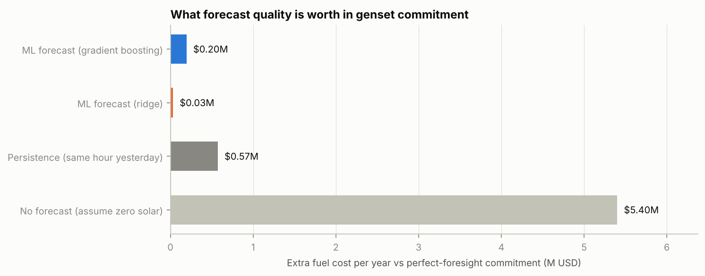

# Mine Energy AI Planner

**Machine-learning forecasting and solar-battery sizing for an off-grid gold mine in Ghana's Ashanti Region.**

Remote mines in West Africa burn diesel for most of their electricity, which makes power one of their largest costs and carbon sources. This project asks two linked questions:

1. **How well can we forecast solar output and mine demand a few hours to a day ahead?** (data analytics + machine learning)
2. **How much solar and storage should the mine build, and what is accurate forecasting worth in fuel?** (renewable energy + mining economics)



> **Read this first: the data is simulated.** The sandbox this was built in could not reach the NASA POWER API, so the default run uses a physics-based weather and mine-load simulator (see [Data](#data)). The site is illustrative (coordinates near Obuasi), not a real mine, and the numbers show what the *method* produces, not what a specific operation would save. Real irradiance can be dropped in with one command (`make real-data`), and the pipeline reruns unchanged.

## Headline results (simulated data, 2023 test year)

| Question | Result |
|---|---|
| Diesel-only baseline | 46.9 M litres/yr, $49.6 M/yr, ~$370 per MWh, 126 kt CO₂/yr |
| Cost-optimal design | **80 MWp PV + 180 MWh battery**: 61% renewable share, saves **$13.6 M/yr** (28%), avoids 76 kt CO₂/yr, simple payback 4.1 years |
| Staged "phase 1" design | **50 MWp PV + 60 MWh battery**: 38% renewable share, saves $11.2 M/yr on $56.8 M capex, payback 3.2 years |
| 6-hour solar forecast | Gradient boosting cuts RMSE **23%** versus smart persistence |
| 24-hour solar forecast | Ridge regression cuts RMSE **16%** versus persistence (gradient boosting: 8%) |
| Day-ahead load forecast | Ridge cuts RMSE **24.5%** versus same-hour-yesterday (gradient boosting: 22%) |
| Prediction intervals | Raw quantile models covered 58% of outcomes at 24 h against an 80% target; conformal calibration fixes this (**83%**) |
| Value of forecasting | Planning diesel genset commitment from ML forecasts wastes **$0.03-0.20 M/yr** versus perfect foresight; persistence wastes $0.57 M; ignoring solar wastes $5.4 M |

## What is in here

| Stage | What it does | Code |
|---|---|---|
| Data | Hourly irradiance, temperature, PV output and mine load for 2021-2023 | `minegrid/solar.py`, `synth.py`, `data.py` |
| Forecasting | Solar (1 h, 6 h, 24 h ahead) and load (day-ahead) with baselines, ridge, gradient boosting, and conformal prediction intervals | `minegrid/forecast.py` |
| Dispatch | Hourly PV + battery + diesel simulation with a part-load fuel curve and a minimum diesel share | `minegrid/dispatch.py` |
| Economics and sizing | Annualised cost, CO₂, payback, grid search over PV and battery size, sensitivity analysis | `minegrid/economics.py`, `optimize.py` |
| Forecast value | What forecast error costs in day-ahead genset commitment | `minegrid/forecast_value.py` |

## Data

- **Weather (default, simulated).** Clear-sky irradiance from solar geometry (Spencer 1971, Haurwitz 1945) multiplied by a clear-sky index from a seasonal three-state Markov cloud model (clear, partly cloudy, overcast) with hourly AR(1) noise, harmattan dust haze and a wet/dry season. It gives 4.7 kWh/m²/day and about 1,360 kWh/kWp/yr, a plausible range for southern Ghana, but it is not calibrated to measurements.
- **Weather (real, optional).** `scripts/fetch_nasa_power.py` downloads hourly all-sky irradiance and temperature from NASA POWER (free, no key). The parser is unit-tested on a payload with the documented structure; the live request itself has not been exercised, so check its printed summary on first use.
- **Mine load (always simulated).** Real mine load is confidential. It is built bottom-up: CIL processing plant (about 11 MW with random trips and planned shutdowns), crushing and conveyors on a shift pattern, pit dewatering that rises in the wet season, and camp load with an evening peak. Mean 15.3 MW, peak 18.7 MW, 134 GWh/yr.

## Method notes

**Forecasting.** Solar is forecast as the clear-sky index and converted back to irradiance with the deterministic clear-sky curve, so models only learn clouds. Evaluation is strictly chronological: train on 2021-2022, test on 2023. Every feature is built from data available at the forecast issue time, and `tests/test_forecast.py` proves it by corrupting all future data and checking the features do not change. Baselines are smart persistence, climatology, same-hour-yesterday and same-hour-last-week.

| Solar nRMSE (% of mean daytime GHI) | 1 h | 6 h | 24 h |
|---|---|---|---|
| Climatology | 44.5 | 44.5 | 44.5 |
| Smart persistence | 11.9 | 38.2 | 47.2 |
| Ridge | 12.0 | 31.8 | **39.5** |
| Gradient boosting | **11.9** | **29.5** | 43.5 |




Gradient boosting was chosen as the primary model before seeing results, and the table above shows it is not always best: at 24 hours the plain linear model wins, a reminder that more complex is not automatically better. Intervals use conformalized quantile regression (Romano et al., 2019) calibrated on the last 120 days of training data.

**Sizing.** A rule-based dispatch (PV first, surplus to battery, battery then diesel) runs for every combination of 0-100 MWp PV and 0-240 MWh battery over three years of hourly data. Diesel fuel follows an affine curve with a no-load term on *online* capacity, so part-loaded generators are inefficient, and a 30% minimum diesel share stands in for spinning reserve on an islanded grid.




The cost curve is flat near the optimum, so a mine does not need the largest system to capture most of the benefit: 30 MWp with no battery already saves $8.8 M/yr at a 24% renewable share, and 50 MWp / 60 MWh saves $11.2 M at 38%.

**Sensitivity.** Savings grow roughly linearly with diesel price, and a stricter minimum diesel share (spinning-reserve rule) lowers both the savings and the renewable share at the optimum. At $0.60/L the best design is solar only with no battery (30 MWp, $4.3 M/yr), so storage only pays once fuel is expensive.



Hollow markers show cases where the optimum sits on the edge of the search grid, so those savings are lower bounds (for example, the 10% minimum-diesel-share curve, and the 30% curve at $1.40/L).

**Value of forecasting.** Gensets burn fuel for all online capacity, so the evening-before decision of how many units to commit depends on forecast quality. On the 50 MWp / 60 MWh design:



## Limitations

- **Simulated data.** The weather generator is a Markov chain, which limits how predictable the day ahead can be. Real weather is richer, and operational forecasts would also use satellite and numerical weather prediction inputs. Treat forecast skill numbers as illustrative.
- **Dispatch is rule-based**, not optimised, and does not use forecasts in real time. There is no battery degradation, ramp-rate or start-up cost, no wind, no grid connection and no price uncertainty.
- **Optimum design curtails 21% of PV.** Real sites also face land, permitting and financing limits that the model ignores.
- **Single site, deterministic prices.** Capex, diesel price and discount rate are explicit assumptions in `minegrid/economics.py`.
- **Interval calibration** uses the end of the training period, which is a different season from much of the test year.

## Run it

```bash
pip install -r requirements.txt
python -m pytest -q                 # 24 tests
python scripts/run_pipeline.py      # about 15 seconds, writes results/ and results/figures/

# optional: rerun on real NASA POWER irradiance (needs internet)
python scripts/fetch_nasa_power.py
python scripts/run_pipeline.py --weather data/raw/nasa_power_weather.csv
```

Results are written to `results/summary.json` and CSV tables (`forecast_*.csv`, `design_grid.csv`, `staged_frontier.csv`, `sensitivity.csv`, `forecast_value.csv`).

## Ideas for extending it

1. Rerun on real NASA POWER data and compare simulated against measured skill.
2. Replace rule-based dispatch with a linear or mixed-integer program, and use forecast intervals for stochastic scheduling.
3. Add wind and a degradation-aware battery model, and study mine-site constraints on land and haul-road dust.
4. Use real SCADA load data if a partner mine can share an anonymised sample.

## References

- Haurwitz, B. (1945). Insolation in relation to cloudiness and cloud density. *Journal of Meteorology*.
- Spencer, J. W. (1971). Fourier series representation of the position of the sun. *Search*.
- Romano, Patterson & Candès (2019). Conformalized quantile regression. *NeurIPS*.
- NASA POWER: https://power.larc.nasa.gov/

## License

MIT
